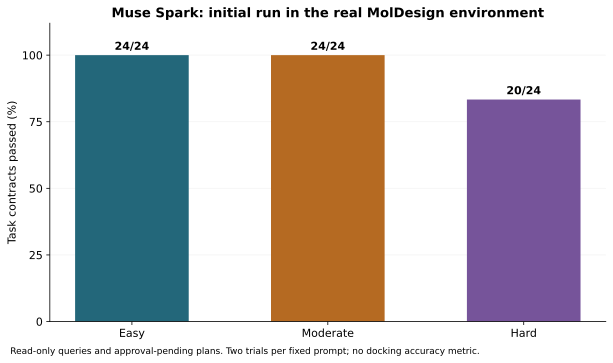
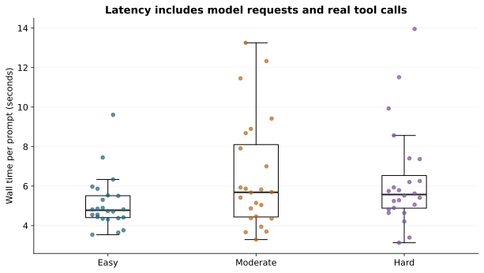
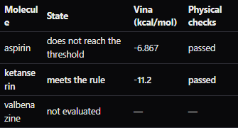

# MolChat Agent

[](https://github.com/srcacahuate619/moldesign-molchat/actions/workflows/ci.yml?query=branch%3Amaster)

**One approval takes a hypothesis about a few molecules from a prompt to an auditable lab notebook.** MolChat helps computational chemistry researchers run a short list of candidate molecules against one target without manually starting each run, checking when to stop, and assembling the evidence for a colleague.

**▶ [Watch the 3-minute demo](https://www.youtube.com/watch?v=luRIXlqWy6I)** · **[Reliability benchmark](benchmarks/README.md)** · [Judge's guide](kit/en/HACKATHON.md) · [Kit en español](kit/es/README.md) · [Architecture](docs/ARQUITECTURA.md) · [CI](https://github.com/srcacahuate619/moldesign-molchat/actions/workflows/ci.yml)

**In the recorded VMAT2 run**, Muse Spark Open turned a six-candidate request into a reviewable plan. With one approval, MolChat coordinated five docking runs, stopped when ketanserin met the score and pose checks, and skipped the sixth candidate. It recorded the outcome in a notebook and delivery ZIP. [The real ZIP, byte for byte](kit/vmat2-run/) · [Run conditions and exact prompt](kit/en/GETTING_STARTED.md#7-try-the-demo-prompt)

**68/72 task contracts passed in the initial live evaluation:** 36 fixed prompts, two real Muse Spark trials per prompt. All four failures remain public: two exposed an incorrect evaluator expectation and two exposed a missing time-budget field. The targeted follow-up passed **6/6**, reported separately. [All outcomes and corrections](benchmarks/RESULTS.md) · [Actual provider calls and harness boundaries](docs/META_EXECUTION.md)

[Submission text and evidence links](kit/en/SUBMISSION.md) · [Final integration check](benchmarks/published/release-check/README.md) · [Frozen handoff](kit/FINAL_RELEASE.md)

| Evidence | Measured result | Reproduce / inspect |
|---|---|---|
| Live Muse Spark: easy / moderate / hard | 24/24 · 24/24 · 20/24 task contracts in the initial run | [36 prompts and every outcome](benchmarks/RESULTS.md) |
| Follow-up after findings | 6/6 targeted trials: corrected empty-search criterion and repaired time-budget schema | [Failures and corrections](benchmarks/FINDINGS.md) |
| Keyless harness, published reference | 220/220 checks in each of 3 repetitions; CI also includes the later release regression cases | `python benchmarks/run_benchmark.py` |
| Two real VMAT2 campaigns | Both: 2 docked, 1 skipped; real audit, video and complete ZIP; same machine and protocol | [Campaign 1: original evidence](benchmarks/published/capsule/README.md) · [Campaign 2: separate evidence](benchmarks/published/capsule-reproduction/README.md) |
| Closing integration check | 16/16 assertions on corrected source, including explicit time limits and no writes before approval | [Final delivery and retained failed attempt](benchmarks/published/release-check/README.md) |

**Limits:** scripted tests measure harness behaviour and live trials measure these fixed model tasks. The two VMAT2 campaigns repeat one environment and protocol; they are not independent scientific replications. The browser capsule partly emulates desktop commands and does not validate the native Windows installer or WebView2. Live planning and browser runs use separately recorded source revisions. Vina scores do not establish biological activity or potency.

## Evidence at a glance



The initial score is preserved, including the evaluator and schema defects. Follow-up results are separate from this graph.



These are live prompt latencies on the recorded machine, not docking speed measurements.



Actual capture from the corrected integration run: valbenazine is marked **not evaluated** after the stop rule was met. [Full approval and notebook captures](benchmarks/published/release-check/README.md) · [Original delivery ZIP](benchmarks/published/release-check/delivery.zip)

The optional [standalone Docker image](benchmarks/README.md#optional-container) covers the sidecar and synthetic benchmark. Its Linux build, real sidecar health check and offline benchmark run are checked by the dedicated Docker CI job.

## Start here

| If you want to… | Go to |
|---|---|
| See what was built for the Meta hackathon and how it uses Muse Spark | [The hackathon kit](kit/en/HACKATHON.md) |
| Inspect the approved-once workflow without keys or MolDesign | [Run the keyless workflow demo](#run-the-keyless-workflow-demo) |
| Use MolDesign with MolChat on your computer, with real docking | [Getting started](kit/en/GETTING_STARTED.md) |
| Add a tool to MolChat or adapt it to another platform | [Extending MolChat](kit/en/EXTENDING.md) |
| Open the standalone chat UI | [Build and open the UI](#build-and-open-the-ui) |

## What we built for the Meta hackathon

**Muse Spark turns a request into structured tool calls.** In the demo, Muse Spark Open (served by Baseten) looks each molecule up in PubChem and fills in the plan. MolChat validates every argument, shows the molecules, the stopping rule and the follow-up actions on a card, and binds the approval to the plan's SHA-256 digest.

**MolChat runs the approved plan.** It coordinates up to 12 sequential evaluations in [MolDesign](https://github.com/srcacahuate619/moldesign-app), applies the approved stopping rule, and records failures and skipped candidates. Depending on the plan, it saves the selected run to Moldex, requests a video in Molcy, and collects a Preparation audit. The notebook records the source of the results. The ZIP manifest lists each deliverable component with its SHA-256 and records missing components. A docking score ranks exploratory hypotheses. [Workflow and file formats](docs/ITERACION_DE_MOLECULAS.md)

**Project boundary.** The hackathon contribution is the agent integration and workflow that turns a request into an approved, executed, traceable run, together with MolDesign's side of that integration (launching MolChat, its host actions and the autopilot view). MolDesign's docking, Moldex, Molcy, and Preparation were already available. The ledger documents reused code, including the original PubChem lookup. [Dated contributions](kit/en/HACKATHON.md#what-was-built-during-the-event-and-what-wasnt) · [Provenance](PROVENANCE.md)

## Run the keyless workflow demo

Use **Python 3.11 or 3.12**, the versions covered by the CI matrix. Run these commands from a fresh clone.

```sh
git clone https://github.com/srcacahuate619/moldesign-molchat.git
cd moldesign-molchat
python -m venv .venv
```

If your launcher is named differently, use `python3.12 -m venv .venv` on macOS/Linux or `py -3.12 -m venv .venv` on Windows. Activate with `source .venv/bin/activate` on macOS/Linux or `.\.venv\Scripts\Activate.ps1` in PowerShell. If activation is restricted, use `.\.venv\Scripts\python.exe` in place of `python` in the following commands.

```sh
python -m pip install -e ".[dev]"
python -c "from pathlib import Path; Path('reports').mkdir(exist_ok=True)"
python -m pytest -q --basetemp=reports/judge-demo tests/server/test_workflow_chat.py
```

The tests drive the hosted chat API with a scripted model response and a simulated MolDesign host. They check that a wrong digest is rejected, that a valid approval runs the workflow only once, that a failed molecule is recorded, and that the run stops before the third candidate. Look under `reports/judge-demo/` for `salida/**/entrega.zip` (this scenario runs in Spanish, so the names are Spanish). Open `cuaderno/cuaderno.md` for the plan and each candidate's outcome, and `MANIFEST.json` for the hashes and the reason the Preparation package is absent. The numbers are synthetic, and a placeholder MP4 exercises the packaging. [Demo source](tests/server/test_workflow_chat.py)

Pytest recreates `reports/judge-demo` on each run. The full local suite is `python -m pytest -q`. The HTTP adapter contract can also be exercised against a local synthetic backend: [Extending MolChat](kit/en/EXTENDING.md#4-build-your-own-lock).

GitHub Actions publishes the synthetic ZIP as `molchat-keyless-demo-synthetic` on runs that include the demo upload step. Signed-in GitHub users can download it from the run's **Artifacts** section. [CI runs](https://github.com/srcacahuate619/moldesign-molchat/actions/workflows/ci.yml)

## Build and open the UI

Use **Node.js 22.12 or later** and run from the repository root in the same virtual environment. If you only want the standalone UI, install `.[server]` in place of `.[dev]`.

```sh
npm --prefix ui ci
npm --prefix ui run build
```

On macOS/Linux:

```sh
MOLCHAT_PROVIDER=fake python -m molchat_agent serve --ui-dist ui/dist
```

In PowerShell:

```powershell
$env:MOLCHAT_PROVIDER = 'fake'
python -m molchat_agent serve --ui-dist ui/dist
```

Open <http://127.0.0.1:8771>, paste the session printed in your terminal, and try the goal **List receptors** in the Plans tab. The keyless provider generates a fixed read-only plan, so you can review it and explore the interface. Scientific runs need MolDesign: see [Getting started](kit/en/GETTING_STARTED.md). Use `npm.cmd` if PowerShell blocks the npm script. [Sidecar and API](docs/SIDECAR.md)

## Build and verify the distribution

```sh
python -m pip install build
python -m build
```

The wheel contains the Python agent; build the UI separately as shown above. To produce the bundle MolDesign stages, build the UI from a clean Git checkout and run:

```sh
python scripts/make_manifest.py --write
python scripts/make_manifest.py --check dist/molchat-vendorizable
```

[Release and compatibility guide](docs/RELEASES.md) · [Security](docs/SEGURIDAD.md) · [License](LICENSE) · [Citation](CITATION.cff)
