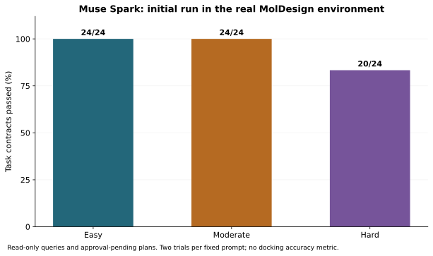

# MolChat reliability evidence

This evaluation asks whether Muse Spark can turn a request into an appropriate, reviewable tool plan, and whether MolChat enforces the approved execution boundary. It does **not** measure biological activity, binding affinity accuracy, or clinical usefulness.

The evidence has three separate layers:

| Layer | Model | Tools and host | What to inspect |
|---|---|---|---|
| Keyless regression | Scripted responses where required | Existing test doubles; also verifies the archived real VMAT2 ZIP | [Scenarios](scenarios.json), [raw results](published/synthetic/results.json) |
| Live model evaluation | Muse Spark Open on Baseten | Real PubChem and account-scoped MolDesign queries; plans await approval | [36 fixed prompts](prompts.json), [every trial and trace](RESULTS.md) |
| Browser campaign | Muse Spark through MolChat inside MolDesign | Real Vina, Preparation and Molcy; capsule simulates desktop commands | [Capsule run](published/capsule/README.md), [original VMAT2 recording](../kit/vmat2-run/) |

The new browser campaign was also [repeated successfully using the public automation script](published/capsule-reproduction/README.md), with a second unchanged delivery ZIP.

The separate [final integration check](published/release-check/README.md) verifies the corrected application revision, explicit 180/600-second limits, zero host writes before approval and the visible skipped-candidate state. The preceding failed attempt is preserved in the [findings](FINDINGS.md).

## Results

[Tables, graphs and all individual outcomes](RESULTS.md) · [Machine-readable summary](results.json) · [How Muse Spark is actually called](../docs/META_EXECUTION.md)



## Reproduce the keyless benchmark

Use Python 3.11 or 3.12, as in CI. From a fresh clone:

```sh
python -m venv .venv
# Activate .venv for your shell.
python -m pip install -e ".[dev]"
python benchmarks/run_benchmark.py
```

The runner invokes existing pytest assertions without rewriting their oracle. It repeats 18 fixed scenario groups three times. Parameterized tests are counted as regression checks, not prompts or independent model trials. A missing group, skipped check, failed assertion or pytest error causes a nonzero exit. Outputs go to `reports/benchmark-run/`: JSON, CSV, JUnit XML, text transcripts, and a generated synthetic delivery ZIP. No API key, live model, Vina or desktop app is needed.

The exported synthetic video is a placeholder and the docking scores are fixtures. The `real-vmat2-archive-integrity` group verifies a previously recorded genuine ZIP; it does not run a new docking campaign.

To repeat just one scenario, run the test path in its `tests` entry with `python -m pytest`. The result JSON records dependency versions, source hashes, the parent Git commit and whether tracked files were modified, so an uncommitted local measurement remains attributable.

## Reproduce the live model evaluation

This is opt-in and sends the new test prompts and tool results to the already authorized provider. It uses paid inference and real network queries. It creates only local benchmark conversation memory; it never approves a docking plan.

1. Open an isolated MolDesign capsule, configure Muse Spark Open on Baseten, and authorize PubChem using MolDesign's settings.
2. Run `python benchmarks/run_live.py --backend http://127.0.0.1:18016 --repetitions 2` with the backend port for your capsule.
3. In a **local automation process**, obtain a fresh session through MolDesign's normal authenticated `/molchat-host/session` endpoint, and POST `{"token": session.token}` to `http://127.0.0.1:18772/start`. Keep this value in memory. Do not paste a key into a command, commit a session file, or publish request headers.

The one-shot loopback receiver exits after the suite. `run_live.py` calls the same `_harness_turn`, `run_tool_loop`, argument validators, provider adapter and tool implementations as the hosted chat. Its wrappers record timing and protocol data; they do not change the model's outputs. Desktop requests from this planning-only suite are answered as unconfirmed and count as failures. Full desktop execution is tested separately in the browser campaign.

Each prompt has explicit task-contract checks in `prompts.json`: required tools, real tool success where applicable, exact plan fields, absent effects, or an honest unavailable result. These checks are narrower than a human review of chemistry or answer quality. Optional suggestions and equivalent tool orders do not count as errors. Two trials expose some variability but cannot establish a population success rate.

The trace includes the exact model identifier, model-visible conversation and tool results, validated arguments, durations and final harness answer. System text is represented by a hash and source references; hidden reasoning, headers and credentials are excluded. The data are synthetic *requests* processed by real services, not simulated service responses.

## Regenerate graphs and verify artifacts

```sh
python -m pip install matplotlib
python benchmarks/render_results.py
python benchmarks/verify_artifacts.py
```

`render_results.py` derives SVG/PNG figures, Markdown tables, CSV and the artifact manifest from measured JSON. Synthetic test durations and live prompt latencies are plotted separately. Durations include tool/network time where stated; they are not docking speed measurements. The original run ZIPs remain unchanged. Re-running the live evaluation will produce different timings and can produce different model decisions.

## Limitations and failures

The public report keeps every scored trial, including failures. See the [findings and corrections](FINDINGS.md) for evaluator mistakes, implementation defects, and follow-up measurements. Correct tool coordination does not establish scientific validity. Capsule results do not validate the Microsoft Store installer, native folder dialogs, the production Tauri origin, or WebView2 rendering.

CI runs the keyless layer and uploads its evidence without provider secrets. Live inference and full docking are deliberately outside routine CI.

## Optional container

Use a Linux Docker engine. The commands below assume the engine can access the local checkout and bind-mount paths; an SSH context resolves mounted paths on its remote host.

```sh
docker build --build-arg SOURCE_COMMIT="$(git rev-parse HEAD)" -f benchmarks/Dockerfile -t molchat-benchmark .
docker run --rm --network none molchat-benchmark python benchmarks/smoke_sidecar.py
docker run --rm --network none molchat-benchmark
```

Run these commands from a clean checkout. In PowerShell, replace `$(git rev-parse HEAD)` with the full commit hash or use `--build-arg "SOURCE_COMMIT=$(git rev-parse HEAD)"`. The source revision is embedded as an image label and an explicit build-argument claim in the results; Git history is excluded from the image and worktree cleanliness inside it is recorded as unknown. File hashes still describe the actual copied inputs.

The image contains the Python sidecar and keyless regression simulator, not MolDesign, Tauri, Vina or Blender. Its default command repeats the maintained synthetic scenario suite three times. The smoke command starts the installed sidecar on a free loopback port, checks `/v1/health`, discards its temporary session output and stops it. The runtime commands above use no external network and receive no provider credentials. Building the image needs internet access for Python dependencies.

**Verification environment:** the `Standalone Docker verification` job in [GitHub Actions](https://github.com/srcacahuate619/moldesign-molchat/actions/workflows/ci.yml?query=branch%3Amaster) builds the Linux image, runs the real sidecar smoke check and then the synthetic benchmark with `--network none`. Its result JSON, JUnit reports and synthetic ZIP are uploaded as `molchat-docker-verification-synthetic`. A successful job verifies those operations; it does not validate scientific docking, GPU rendering or a desktop installer. The original evidence capture had no available local Docker daemon; the later CI job verifies the container independently.

To retain local outputs in Bash or PowerShell, create `reports/docker-verification`, then mount it:

```sh
docker run --rm --network none --mount "type=bind,src=$(pwd)/reports/docker-verification,dst=/molchat/reports/benchmark-run" molchat-benchmark
```

For an interactive API inside the container, run `docker run --rm -e MOLCHAT_PROVIDER=fake molchat-benchmark python -m molchat_agent serve`. The sidecar intentionally binds to container loopback; ordinary port publishing does not expose it. This image is an agent/simulator verification path, not the full MolDesign installation.
