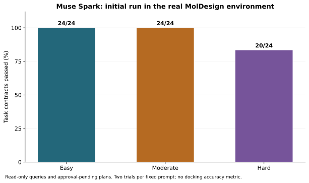
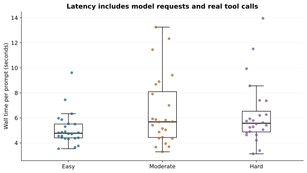
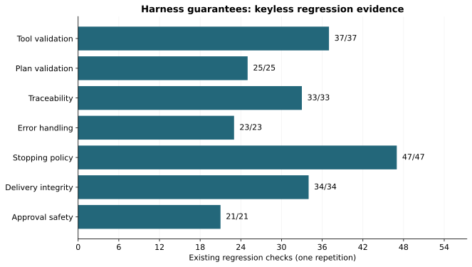

# Measured results

Generated by `python benchmarks/render_results.py` from the published JSON. Each pass means every predeclared automated task-contract criterion passed; it is not a human assessment of scientific prose.

| Level | Distinct prompts | Trials passed | Median wall time | Min–max |
|---|---:|---:|---:|---:|
| Easy | 12 | 24/24 | 4.78 s | 3.54–9.61 s |
| Moderate | 12 | 24/24 | 5.69 s | 3.29–13.25 s |
| Hard | 12 | 20/24 | 5.57 s | 3.13–13.95 s |

The initial score is preserved. H09 had an incorrect empty-catalogue expectation; H12 exposed missing time-budget fields. The follow-up below uses the repaired source and the documented H09 criterion correction. It is not merged into the 72 initial trials.

| Follow-up | Passed | What changed | Traces |
|---|---:|---|---|
| H09 | 3/3 | Corrected evaluator: successful query with zero matches | [r1](published/followup/H09-r1.json) · [r2](published/followup/H09-r2.json) · [r3](published/followup/H09-r3.json) |
| H12 | 3/3 | Repaired model-facing time-budget schema | [r1](published/followup/H12-r1.json) · [r2](published/followup/H12-r2.json) · [r3](published/followup/H12-r3.json) |

## Every prompt and trial

| Prompt | Level | Trial | Result | Wall time | Failed criteria | Trace |
|---|---|---:|---|---:|---|---|
| E01 | easy | 1 | PASS | 5.97 s | — | [JSON](published/live/E01-r1.json) |
| E02 | easy | 1 | PASS | 4.86 s | — | [JSON](published/live/E02-r1.json) |
| E03 | easy | 1 | PASS | 4.35 s | — | [JSON](published/live/E03-r1.json) |
| E04 | easy | 1 | PASS | 4.31 s | — | [JSON](published/live/E04-r1.json) |
| E05 | easy | 1 | PASS | 9.61 s | — | [JSON](published/live/E05-r1.json) |
| E06 | easy | 1 | PASS | 4.38 s | — | [JSON](published/live/E06-r1.json) |
| E07 | easy | 1 | PASS | 4.41 s | — | [JSON](published/live/E07-r1.json) |
| E08 | easy | 1 | PASS | 3.54 s | — | [JSON](published/live/E08-r1.json) |
| E09 | easy | 1 | PASS | 4.44 s | — | [JSON](published/live/E09-r1.json) |
| E10 | easy | 1 | PASS | 5.31 s | — | [JSON](published/live/E10-r1.json) |
| E11 | easy | 1 | PASS | 5.53 s | — | [JSON](published/live/E11-r1.json) |
| E12 | easy | 1 | PASS | 6.34 s | — | [JSON](published/live/E12-r1.json) |
| M01 | moderate | 1 | PASS | 5.93 s | — | [JSON](published/live/M01-r1.json) |
| M02 | moderate | 1 | PASS | 8.68 s | — | [JSON](published/live/M02-r1.json) |
| M03 | moderate | 1 | PASS | 5.67 s | — | [JSON](published/live/M03-r1.json) |
| M04 | moderate | 1 | PASS | 5.15 s | — | [JSON](published/live/M04-r1.json) |
| M05 | moderate | 1 | PASS | 5.04 s | — | [JSON](published/live/M05-r1.json) |
| M06 | moderate | 1 | PASS | 3.70 s | — | [JSON](published/live/M06-r1.json) |
| M07 | moderate | 1 | PASS | 4.36 s | — | [JSON](published/live/M07-r1.json) |
| M08 | moderate | 1 | PASS | 11.45 s | — | [JSON](published/live/M08-r1.json) |
| M09 | moderate | 1 | PASS | 13.25 s | — | [JSON](published/live/M09-r1.json) |
| M10 | moderate | 1 | PASS | 8.90 s | — | [JSON](published/live/M10-r1.json) |
| M11 | moderate | 1 | PASS | 4.46 s | — | [JSON](published/live/M11-r1.json) |
| M12 | moderate | 1 | PASS | 5.82 s | — | [JSON](published/live/M12-r1.json) |
| H01 | hard | 1 | PASS | 5.75 s | — | [JSON](published/live/H01-r1.json) |
| H02 | hard | 1 | PASS | 5.93 s | — | [JSON](published/live/H02-r1.json) |
| H03 | hard | 1 | PASS | 5.28 s | — | [JSON](published/live/H03-r1.json) |
| H04 | hard | 1 | PASS | 4.21 s | — | [JSON](published/live/H04-r1.json) |
| H05 | hard | 1 | PASS | 3.40 s | — | [JSON](published/live/H05-r1.json) |
| H06 | hard | 1 | PASS | 13.95 s | — | [JSON](published/live/H06-r1.json) |
| H07 | hard | 1 | PASS | 6.26 s | — | [JSON](published/live/H07-r1.json) |
| H08 | hard | 1 | PASS | 4.64 s | — | [JSON](published/live/H08-r1.json) |
| H09 | hard | 1 | FAIL | 8.56 s | search_receptors reports not_found | [JSON](published/live/H09-r1.json) |
| H10 | hard | 1 | PASS | 11.51 s | — | [JSON](published/live/H10-r1.json) |
| H11 | hard | 1 | PASS | 5.52 s | — | [JSON](published/live/H11-r1.json) |
| H12 | hard | 1 | FAIL | 6.21 s | plan preserves per_molecule_timeout_s; plan preserves budget_s | [JSON](published/live/H12-r1.json) |
| E01 | easy | 2 | PASS | 5.51 s | — | [JSON](published/live/E01-r2.json) |
| E02 | easy | 2 | PASS | 4.82 s | — | [JSON](published/live/E02-r2.json) |
| E03 | easy | 2 | PASS | 4.82 s | — | [JSON](published/live/E03-r2.json) |
| E04 | easy | 2 | PASS | 5.87 s | — | [JSON](published/live/E04-r2.json) |
| E05 | easy | 2 | PASS | 7.45 s | — | [JSON](published/live/E05-r2.json) |
| E06 | easy | 2 | PASS | 4.74 s | — | [JSON](published/live/E06-r2.json) |
| E07 | easy | 2 | PASS | 4.72 s | — | [JSON](published/live/E07-r2.json) |
| E08 | easy | 2 | PASS | 3.65 s | — | [JSON](published/live/E08-r2.json) |
| E09 | easy | 2 | PASS | 3.76 s | — | [JSON](published/live/E09-r2.json) |
| E10 | easy | 2 | PASS | 4.54 s | — | [JSON](published/live/E10-r2.json) |
| E11 | easy | 2 | PASS | 4.55 s | — | [JSON](published/live/E11-r2.json) |
| E12 | easy | 2 | PASS | 4.90 s | — | [JSON](published/live/E12-r2.json) |
| M01 | moderate | 2 | PASS | 7.00 s | — | [JSON](published/live/M01-r2.json) |
| M02 | moderate | 2 | PASS | 5.70 s | — | [JSON](published/live/M02-r2.json) |
| M03 | moderate | 2 | PASS | 5.42 s | — | [JSON](published/live/M03-r2.json) |
| M04 | moderate | 2 | PASS | 5.87 s | — | [JSON](published/live/M04-r2.json) |
| M05 | moderate | 2 | PASS | 4.38 s | — | [JSON](published/live/M05-r2.json) |
| M06 | moderate | 2 | PASS | 3.29 s | — | [JSON](published/live/M06-r2.json) |
| M07 | moderate | 2 | PASS | 3.94 s | — | [JSON](published/live/M07-r2.json) |
| M08 | moderate | 2 | PASS | 12.33 s | — | [JSON](published/live/M08-r2.json) |
| M09 | moderate | 2 | PASS | 9.42 s | — | [JSON](published/live/M09-r2.json) |
| M10 | moderate | 2 | PASS | 7.91 s | — | [JSON](published/live/M10-r2.json) |
| M11 | moderate | 2 | PASS | 3.67 s | — | [JSON](published/live/M11-r2.json) |
| M12 | moderate | 2 | PASS | 4.87 s | — | [JSON](published/live/M12-r2.json) |
| H01 | hard | 2 | PASS | 5.63 s | — | [JSON](published/live/H01-r2.json) |
| H02 | hard | 2 | PASS | 5.41 s | — | [JSON](published/live/H02-r2.json) |
| H03 | hard | 2 | PASS | 4.83 s | — | [JSON](published/live/H03-r2.json) |
| H04 | hard | 2 | PASS | 5.25 s | — | [JSON](published/live/H04-r2.json) |
| H05 | hard | 2 | PASS | 3.13 s | — | [JSON](published/live/H05-r2.json) |
| H06 | hard | 2 | PASS | 4.64 s | — | [JSON](published/live/H06-r2.json) |
| H07 | hard | 2 | PASS | 7.40 s | — | [JSON](published/live/H07-r2.json) |
| H08 | hard | 2 | PASS | 5.06 s | — | [JSON](published/live/H08-r2.json) |
| H09 | hard | 2 | FAIL | 7.37 s | search_receptors reports not_found | [JSON](published/live/H09-r2.json) |
| H10 | hard | 2 | PASS | 9.93 s | — | [JSON](published/live/H10-r2.json) |
| H11 | hard | 2 | PASS | 4.90 s | — | [JSON](published/live/H11-r2.json) |
| H12 | hard | 2 | FAIL | 5.79 s | plan preserves per_molecule_timeout_s; plan preserves budget_s | [JSON](published/live/H12-r2.json) |

## What the model requested and what actually ran

These are tool calls in the initial live planning suite, not docking jobs. `propose_iteration` creates an unapproved card. Descriptor and catalogue operations are read-only. A matching call count does not prove that every plan field was correct; H12 demonstrates that distinction.

| Tool | Requested by Muse Spark | Actually executed after validation |
|---|---:|---:|
| `compute_properties` | 26 | 26 |
| `propose_iteration` | 20 | 20 |
| `pubchem_lookup` | 18 | 18 |
| `search_receptors` | 6 | 6 |
| `show_property_comparison` | 2 | 2 |

Malformed or unauthorized requests are exercised separately by the keyless tool-protocol, approval and adversarial scenario groups. They are not passed off as adversarial successes by the live model.

## Keyless harness checks

| Metric | Checks passed, first repetition |
|---|---:|
| tool validation | 37/37 |
| plan validation | 25/25 |
| traceability | 33/33 |
| error handling | 23/23 |
| stopping policy | 47/47 |
| delivery integrity | 34/34 |
| approval safety | 21/21 |

Repetitions: 3. Per-run totals: 220/220, 220/220, 220/220.

Durations measure this machine and these dependencies. Repeated trials share a machine and are not independent population samples. No confidence interval or percentile is claimed from two trials per prompt.
