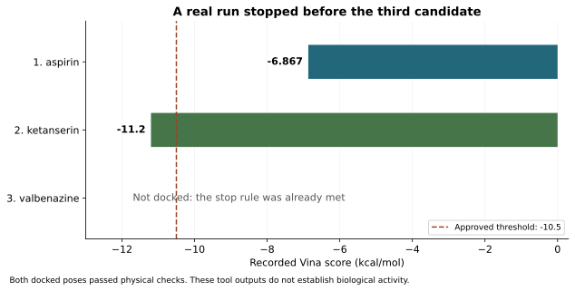
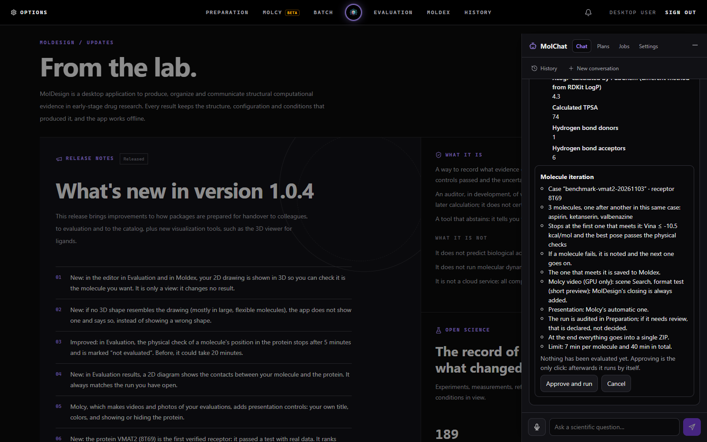
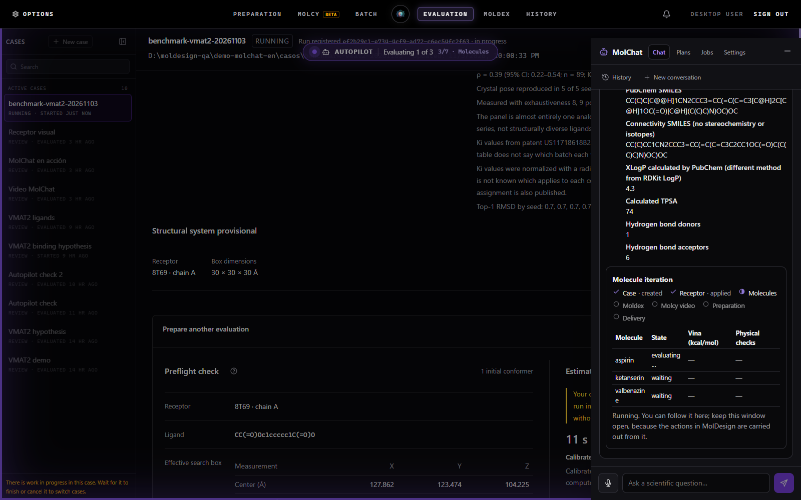
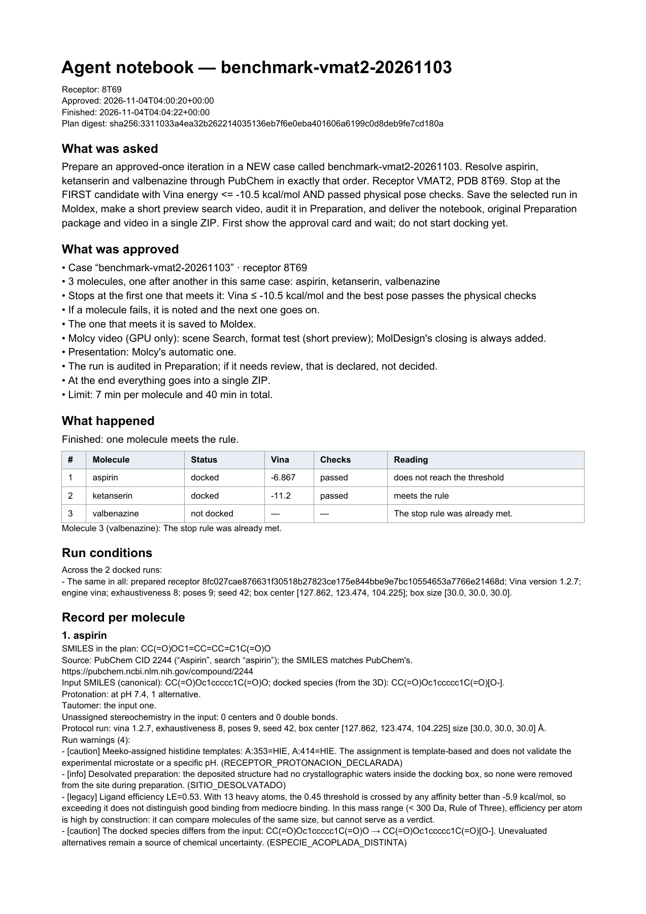

# Real browser campaign: VMAT2

This is a new execution in the isolated local MolDesign capsule, distinct from the earlier [recorded demo](../../../kit/vmat2-run/README.md). It ran on November 3, 2026 in Mexico City (November 4 UTC). The delivered ZIP is published unchanged.

| Candidate | Vina (kcal/mol) | Physical checks | Outcome |
|---|---:|---|---|
| Aspirin | −6.867 | passed | Does not reach −10.5 |
| Ketanserin | −11.2 | passed | Selected; rule satisfied |
| Valbenazine | — | — | Not docked: stop rule already met |



One approval initiated the campaign. Before it, zero host mutations were dispatched; an incorrect digest returned HTTP 409. Repeating the valid approval after completion returned HTTP 200 and dispatched no further evaluation. Preparation exported its own package with **REVIEW**, zero blockers and six requirements still under review. Molcy rendered an actual short search video. The final delivery has five components and no declared missing pieces.

## Inspect the evidence

| Artifact | Purpose |
|---|---|
| [delivery.zip](delivery.zip) | Original delivery. SHA-256 `6e11d8fcc1ee1f46dd0a65e7851fffa879393e636da206bc5f19e998368644e1` |
| [MANIFEST.json](MANIFEST.json) | Component paths, origins and hashes, copied from the original delivery |
| [notebook.md](notebook.md), [notebook.json](notebook.json), [notebook.pdf](notebook.pdf) | What was requested, approved, measured and skipped, copied from the ZIP |
| [execution.json](execution.json) | Sanitized browser chat/workflow traffic and approval checks; no request headers |
| [conditions.json](conditions.json) | Revisions, environment and capsule emulation boundaries |

The ZIP contains the JSON/Markdown/PDF notebook, MolDesign's unchanged Preparation package, and the MP4 rendered by Molcy. The agent notebook itself is generated from recorded results, not written by the model. The timestamps inside the notebook distinguish approval from completion with the video; the PDF's fixed metadata date supports deterministic output and is not the experiment date.

## Four real views



The card names the ordered candidates, receptor, threshold, physical checks and requested outputs before execution.



MolDesign is processing aspirin while the autopilot marker identifies the agent's actions. This is a browser capture of the capsule, not a mockup.

[The stop outcome in the older pinned UI](screenshots/03-stop.png)

The older UI left the skipped candidate labelled “waiting”. The backend and notebook correctly recorded it as not docked. This discrepancy was found by this run and corrected in the source runner's terminal row events; it is retained here as measured evidence. [Finding and verification](../../FINDINGS.md)



The notebook records valbenazine as not docked and retains source identities, actual docked species, protocol, warnings and Preparation's unresolved verdict.

## Reproduce and verify

With a configured local Windows capsule and an installed Edge browser:

```sh
npm install --prefix benchmarks
node benchmarks/run_capsule.cjs --url http://localhost:13016/ --backend http://127.0.0.1:18016
```

Use your capsule's ports. The script uses the capsule's normal browser login, obtains a session in memory, submits a new case, verifies the pending card, probes a wrong digest, approves it, follows the render, checks the stop counts and downloads the real outputs. It expects this recorded protocol to stop at ketanserin; a different outcome fails the script and remains in its execution report. It does not force a scientific result or replace the model's decisions. A reproducing machine must already have the receptor, Vina, PubChem authorization, provider credentials, Blender and Molcy dependencies available.

```sh
python benchmarks/verify_artifacts.py
```

Capsule boundaries and the limited scientific interpretation of Vina scores are described in [the findings](../../FINDINGS.md). This run does not establish biological activity or installer compatibility.
