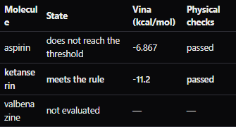

# Final integration check

**Passed: all 16 browser assertions.** This closing check runs the corrected MolChat application source at `345856ae940e5db54016e55de32391afb2d54e5f`, staged as a verified external sidecar in the existing isolated MolDesign capsule. It reuses the three-candidate VMAT2 campaign and adds explicit time limits; it does not expand the 36-prompt evaluation.

The previous attempt on `49df407` [failed before approval](../release-attempt-49df407/execution.json): the model created one empty case. No docking was approved or started. That trace is retained unchanged. The correction removes direct host mutation tools from recognized plan/approval requests and threshold campaigns, and blocks direct writes once a workflow card exists. [Regression evidence and scope](../../FINDINGS.md)

## What passed

| Check | Observed |
|---|---|
| Executed MolChat revision | `345856ae940e`, reported by the actual sidecar |
| Staged package | 82 files, verified by both MolChat and MolDesign |
| Requested limits | 180 seconds per molecule; 600 seconds for the iteration |
| Approval card | “Limit: 3 min per molecule and 10 min in total.” |
| Host mutations before approval | 0 |
| Deliberately incorrect approval digest | HTTP 409 |
| Docking | Aspirin −6.867, ketanserin −11.2 kcal/mol; both physical checks passed |
| Stop | Ketanserin selected; valbenazine not docked |
| Visible skipped row | `not evaluated` |
| Moldex / Preparation | Saved / REVIEW, with scientific decisions left open |
| Molcy | Real MP4 completed |
| Delivery | Five original components; no missing pieces |
| Repeated approval | HTTP 200; no additional evaluation |

## Original evidence

- [execution.json](execution.json): browser traffic and all 16 assertions; credentials and request headers excluded.
- [conditions.json](conditions.json): source revision, verified package hashes, exact time-limit check and capsule boundary.
- [sidecar-manifest.json](sidecar-manifest.json): the original manifest of the actual staged application.
- [delivery.zip](delivery.zip): unchanged output, SHA-256 `3e010b4df21f8350a1c32bc2d1ae85405ecd01ceb8ee39cd2f5ae906e8c448d2`.
- [MANIFEST.json](MANIFEST.json): copied directly from that ZIP.
- [notebook.md](notebook.md), [notebook.json](notebook.json), [notebook.pdf](notebook.pdf): exact copies of the ZIP members.



[Approval card](screenshots/01-approval.png) · [Automated execution](screenshots/02-running.png) · [Exported notebook](screenshots/04-notebook.png)

## Repeat this check

Stage the application revision that you want to verify using the [getting-started guide](../../../kit/en/GETTING_STARTED.md#use-a-newer-molchat), then use its actual commit prefix in the command:

```sh
node benchmarks/run_capsule.cjs --case benchmark-release-reproduction --expected-commit 345856a --per-molecule-timeout-s 180 --budget-s 600 --check-skipped-label true
```

The capsule must already provide Muse Spark credentials, PubChem permission and the scientific/rendering dependencies. The runner fails and retains its report if the environment or result differs; it does not force a score or substitute an output. Capsule emulation, the older MolDesign frontend export and installer limitations remain declared in [the host conditions](../capsule/conditions.json). This is an engineering integration check, not evidence of pharmacological activity.
